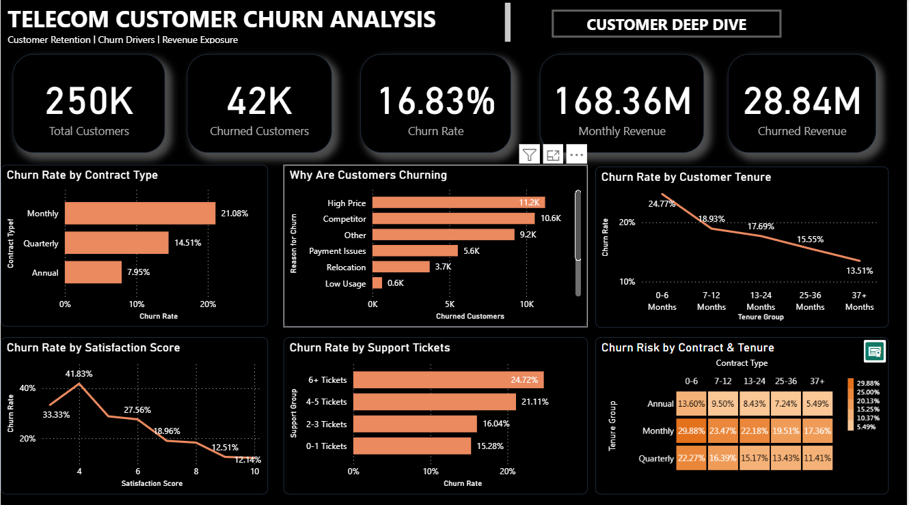
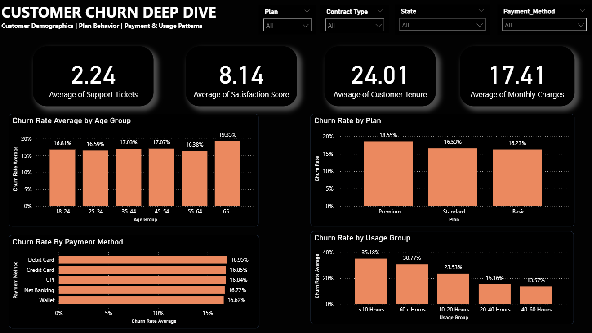

# Telecom Customer Churn Analysis

An end-to-end data analytics project analyzing customer churn, customer behavior, and revenue exposure using Python, SQL, and Power BI.

## 📌 Project Overview

Customer churn is a major business challenge for telecom companies. This project analyzes customer, subscription, usage, payment, support, and churn data to identify customer segments with higher observed churn and understand the associated revenue exposure.

The project follows a complete analytics workflow:

**Data Generation → Data Quality Check → Data Cleaning → EDA → SQL Analysis → Analytical Dataset → Power BI Dashboard**

---

## 🎯 Business Objectives

- Measure the overall customer churn rate.
- Identify customer segments with higher observed churn.
- Compare churn across contract types and customer tenure.
- Analyze the relationship between support interactions and churn.
- Understand major reported churn reasons.
- Estimate the revenue exposure associated with churn.
- Build an interactive dashboard for business analysis.

---

## 📊 Dataset

The project uses synthetic telecom customer data containing approximately **250,000 customers**.

The data is organized into multiple tables covering:

- Customer information
- Subscription details
- Usage behavior
- Customer status
- Churn information

The complete datasets are not included in this repository because of their size. The Python data-generation and processing scripts are provided to reproduce the workflow.

---

## 🛠️ Technologies Used

### Programming & Data Analysis
- Python
- Pandas
- NumPy
- Matplotlib

### Database & Querying
- SQL
- SQLite

### Business Intelligence
- Microsoft Power BI
- DAX

### Analytics
- Data Cleaning
- Exploratory Data Analysis
- KPI Development
- Customer Segmentation
- Trend Analysis
- Business Analysis
- Data Visualization

---

## 🔄 Project Workflow

### 1. Data Generation

Synthetic telecom datasets were generated to simulate a large-scale customer environment.

### 2. Data Quality Validation

The generated datasets were checked for:

- Missing values
- Duplicate records
- Data consistency
- Record counts
- Valid customer relationships

### 3. Data Cleaning

Python was used to clean and prepare the datasets for analysis.

### 4. Exploratory Data Analysis

EDA was performed to understand:

- Customer behavior
- Churn patterns
- Contract types
- Tenure groups
- Support interactions
- Payment methods
- Churn reasons
- Revenue exposure

### 5. SQL Business Analysis

SQL was used for business-oriented analysis including:

- Aggregations
- Group-based churn calculations
- Contract analysis
- Tenure analysis
- Churn reason analysis
- KPI calculations

### 6. Power BI Dashboard

The processed analytical data was used to build an interactive Power BI dashboard with multiple analytical views.

---

# 📈 Key Results

| KPI | Result |
|---|---:|
| Total Customers | 250,000 |
| Active Customers | 207,927 |
| Churned Customers | 42,073 |
| Overall Churn Rate | 16.83% |
| Monthly Revenue | ₹168.36M |
| Churned Revenue | ₹28.84M |
| Churned Revenue Share | 17.13% |

---

## 🔍 Key Findings

### Contract Type

Monthly-contract customers showed the highest observed churn rate:

- **Monthly:** 21.08%
- **Quarterly:** 14.51%
- **Annual:** 7.95%

This indicates that customers on monthly contracts were the highest-churn segment in the analyzed dataset.

### Customer Tenure

Observed churn was highest among newer customers:

- **0–6 months:** 24.77%
- **7–12 months:** 18.93%
- **13–24 months:** 17.69%
- **25–36 months:** 15.55%
- **37+ months:** 13.51%

### Support Interactions

Customers with more support tickets showed higher observed churn:

- **0–1 tickets:** 15.28%
- **2–3 tickets:** 16.04%
- **4–5 tickets:** 21.11%
- **6+ tickets:** 24.72%

### Reported Churn Reasons

The largest reported churn categories were:

- High Price
- Competitor
- Other
- Payment Issues
- Relocation
- Low Usage

> These findings describe observed relationships in the analyzed data and should not be interpreted as causal relationships.

---

# 📊 Power BI Dashboard

## Executive Churn Overview

The first dashboard provides a high-level view of:

- Total customers
- Churned customers
- Churn rate
- Monthly revenue
- Churned revenue
- Churn by contract type
- Churn by tenure
- Reported churn reasons
- Churn by satisfaction
- Churn by support tickets
- Churn risk across contract and tenure combinations



---

## Customer Deep Dive

The second dashboard focuses on customer-level segmentation and behavioral patterns.

It includes analysis of:

- Age groups
- Customer plans
- Payment methods
- Usage groups
- Customer support behavior
- Satisfaction
- Customer tenure



---

# 📁 Project Structure

```text
Project_2_Telecom_Churn/
│
├── data/
│   ├── raw/
│   └── processed/
│
├── powerbi/
│   └── Telecom_Customer_Churn_Analysis.pbix
│
├── python/
│   ├── data_cleaning.py
│   ├── data_generation.py
│   ├── data_quality_check.py
│   └── eda.py
│
├── reports/
│   ├── churn_by_contract.csv
│   ├── churn_by_plan.csv
│   ├── churn_by_tenure.csv
│   └── churn_reasons.csv
│
├── screenshots/
│   ├── churn_overview.png
│   └── customer_deep_dive.png
│
├── sql/
│   ├── business_analysis.sql
│   ├── customer_churn_analysis.sql
│   ├── create_analytical_dataset.py
│   ├── database_setup.py
│   └── run_sql_analysis.py
│
├── .gitignore
└── README.md
